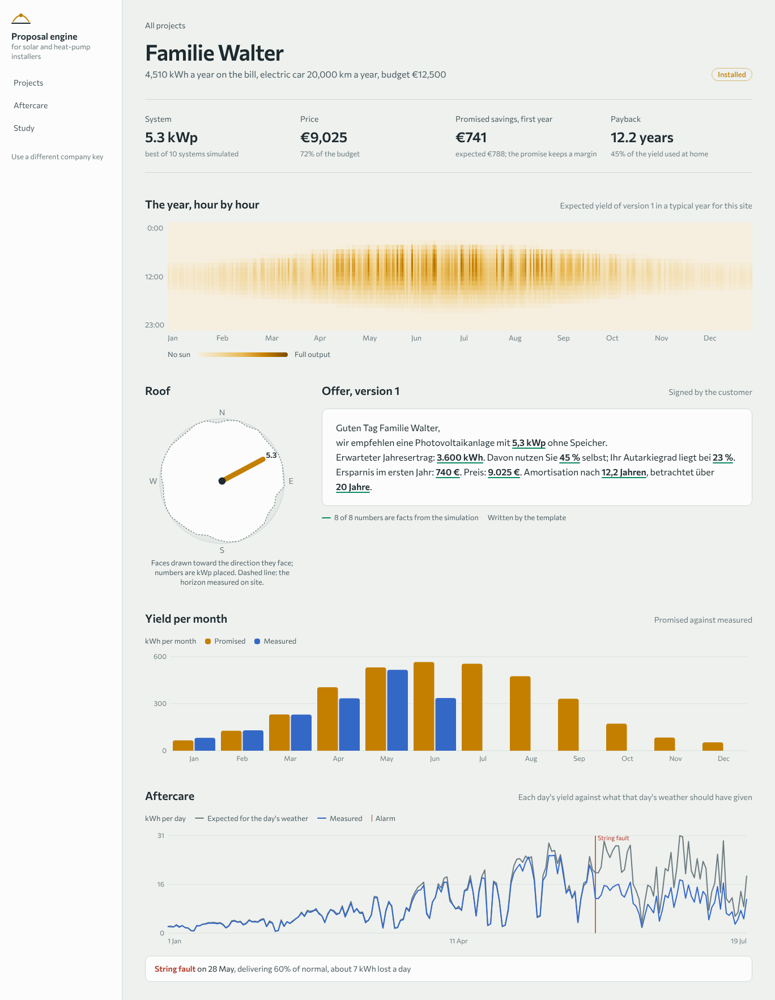
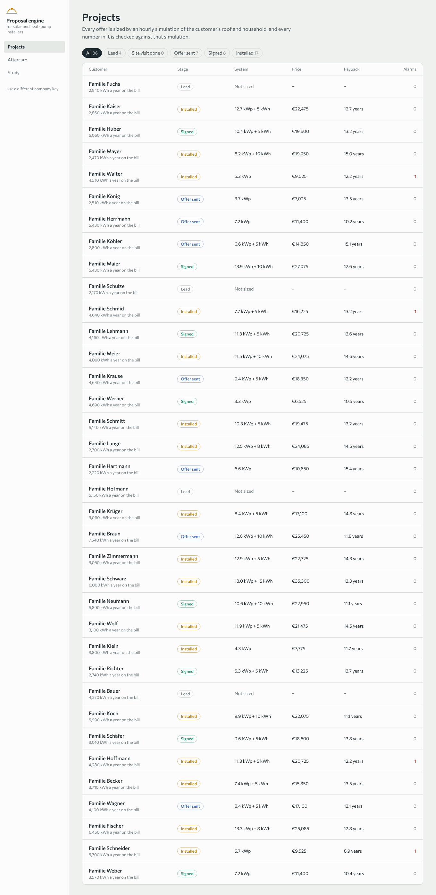
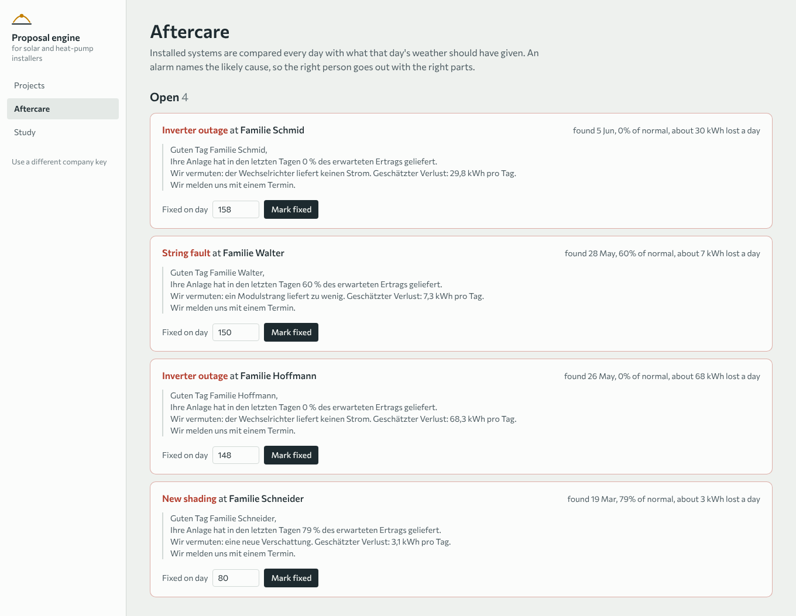
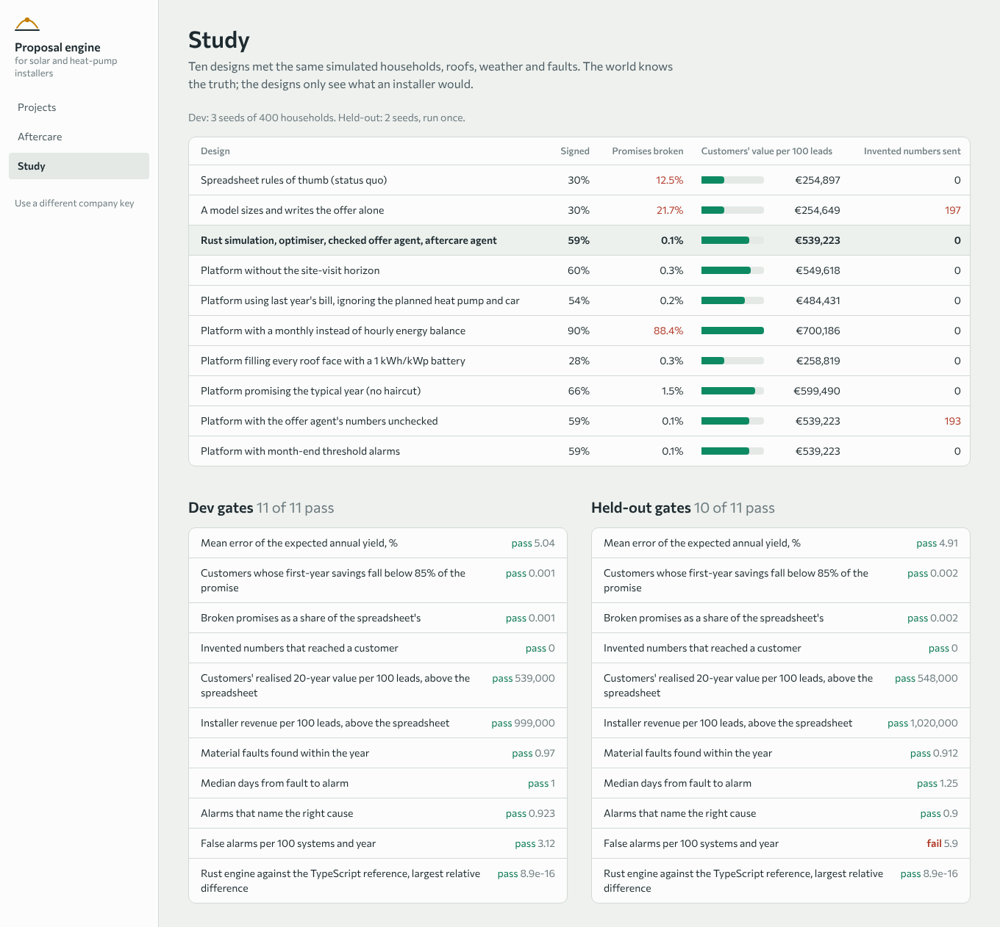
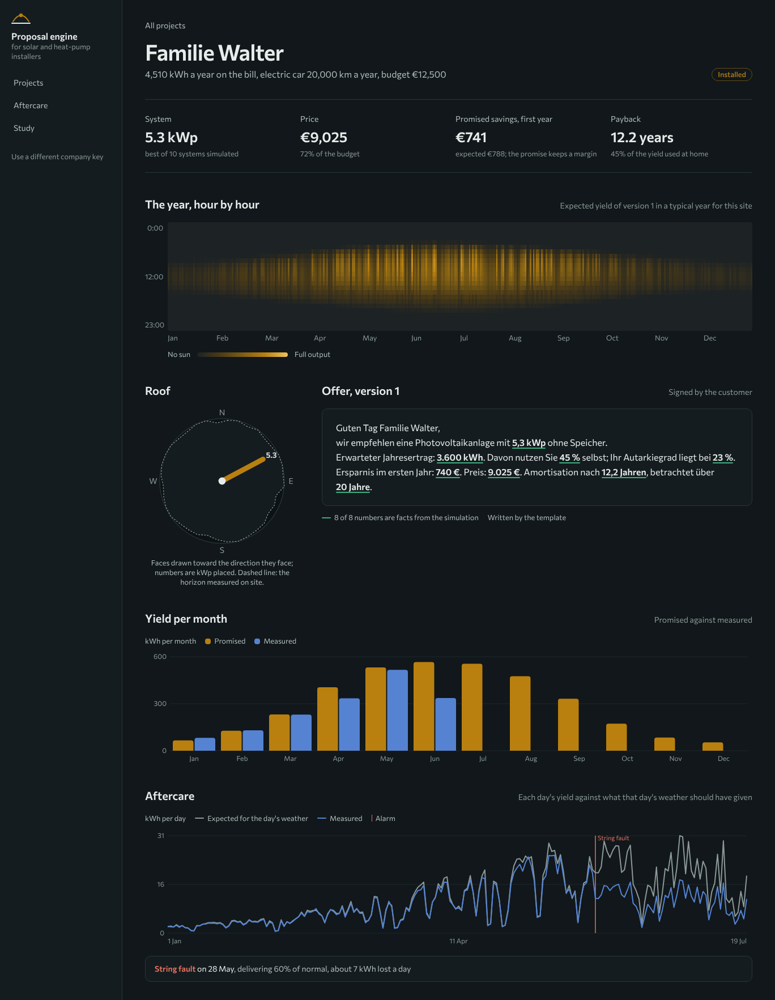

# installer-proposal-engine

**Offers for solar, battery and heat-pump installers whose numbers hold up, and aftercare that finds faults the day they start.**

A Rust simulation sizes every system hour by hour for the customer's roof, horizon and household (including the heat
pump and car they plan). An offer agent writes the letter, but code decides every number in it. After installation
an aftercare agent compares each day's yield with what that day's weather should have given, and names the likely
cause. TypeScript on Node, PostgreSQL through Prisma 7, React with Tailwind, and the energy model in Rust.



## Why

An installer's offer promises savings. If the first year falls short, the installer gets the call, the review and
sometimes the bill. Two things decide whether a promise holds:
- whether the numbers come from an hourly simulation of this roof and this household, or from rules of thumb;
- whether anything a writer adds, human or model, is checked before the customer reads it.

After installation, a broken string or an inverter that stopped is usually found when the customer looks at the
bill, weeks later.

Reonic already ships AI chat, agents, lead scoring and offer creation for installers. This project explores the two
places where a number given to a customer has to be right: the offer, and the first year after it.

## How it works

```
lead + site visit ──► typical year for the site ──► Rust: every face × battery option, 8,760 hours ──► best 20-year value within budget
 (bill, heat pump,      (stand-in for PVGIS)          (napi-rs addon; TypeScript reference, parity 1e-9)          │
  car, roof, horizon)                                                                                           ▼
                                        facts (kWp, price, yield, self-use, savings, payback) ──► writer drafts ──► checker: every number a fact?
                                                                                                    ▲   no: redraft, then template │ yes
                                                                                                    └──────────────────────────────┘ ▼  offer
installed system ──► daily measured yield ──┐
satellite irradiance ──► Rust: as-built system in that day's weather ──► ratio vs its own normal ──► CUSUM ──► cause from the loss shape ──► alarm + letter
```

- **Sizing** (`packages/core/src/plan.ts`): every combination of empty, half or full roof faces with 0–15 kWh of
  battery is simulated. The planner keeps the best 20-year value for the customer within their budget. The promise
  keeps a 6% margin below the expected savings (ADR-0003).
- **Offer agent** (`packages/core/src/offer`): the writer sees only the facts. `checkDraft` reads every number with
  a unit in German or English formatting and blocks any that is not a fact (ADR-0002). With `ANTHROPIC_API_KEY` set
  the writer is Claude; the lab uses a simulated writer that sometimes changes numbers and invents claims.
- **Aftercare agent** (`packages/core/src/aftercare`): finds outages, string faults, new shading and soiling. It
  flags monitoring gaps as offline, not as faults (ADR-0004).

## Results

Each design meets the same simulated households, roofs and weather, the same customer decisions, and the same
faults. The world knows the truth; the designs only see what an installer would: the bill, the plans, the roof
and a measured horizon with errors.

<!-- results:start -->
Dev: 3 seeds × 400 households, every design on the same households, weather and faults. Engine: rust. **11 of 11 gates pass.**

| | Spreadsheet (status quo) | Platform |
|---|---:|---:|
| Customers whose savings fall below 85% of the promise | 12.5% | **0.1%** |
| Offers signed | 30% | **59%** |
| Customers' realised 20-year value per 100 leads | €254,897 | **€539,223** |
| Installer revenue per 100 leads | €590,583 | **€998,645** |
| Material faults found within the year | 94% | **97%** |
| Median days from fault to alarm | 47.3 | **1.0** |
| False alarms per 100 systems and year | 116.0 | **3.1** |

**Status quo, a model alone, and the platform**

| Design | Signed | Broken promises | Yield error | Promise vs reality | Customer value per 100 leads | Installer revenue per 100 leads | Invented numbers sent |
|---|---:|---:|---:|---:|---:|---:|---:|
| Spreadsheet rules of thumb (status quo) | 30% | 12.5% | 8.7% | -0.6% | €254,897 | €590,583 | 0 |
| A model sizes and writes the offer alone | 30% | 21.7% | 14.2% | +3.8% | €254,649 | €592,473 | 197 |
| **Rust simulation, optimiser, checked offer agent, aftercare agent** | 59% | **0.1%** | 5.0% | -6.6% | €539,223 | €998,645 | 0 |

**Ablations: what each part of the platform is worth**

| Design | Signed | Broken promises | Yield error | Promise vs reality | Customer value per 100 leads | Installer revenue per 100 leads | Invented numbers sent |
|---|---:|---:|---:|---:|---:|---:|---:|
| **Rust simulation, optimiser, checked offer agent, aftercare agent** | 59% | **0.1%** | 5.0% | -6.6% | €539,223 | €998,645 | 0 |
| Platform without the site-visit horizon | 60% | 0.3% | 5.5% | -5.2% | €549,618 | €1,031,567 | 0 |
| Platform using last year's bill, ignoring the planned heat pump and car | 54% | 0.2% | 5.1% | -10.7% | €484,431 | €855,813 | 0 |
| Platform with a monthly instead of hourly energy balance | 90% | 88.4% | 5.1% | +32.6% | €700,186 | €1,281,706 | 0 |
| Platform filling every roof face with a 1 kWh/kWp battery | 28% | 0.3% | 5.0% | -6.8% | €258,819 | €547,126 | 0 |
| Platform promising the typical year (no haircut) | 66% | 1.5% | 5.1% | -0.6% | €599,490 | €1,129,939 | 0 |
| Platform with the offer agent's numbers unchecked | 59% | 0.1% | 5.0% | -6.6% | €539,223 | €998,645 | 193 |
| Platform with month-end threshold alarms | 59% | 0.1% | 5.0% | -6.6% | €539,223 | €998,645 | 0 |

**Aftercare**

| Design | Material faults found | Median days to alarm | Right cause | False alarms per 100 systems | Data gaps flagged | Energy lost per fault |
|---|---:|---:|---:|---:|---:|---:|
| Spreadsheet rules of thumb (status quo) | 94% | 47.3 | 0% | 116.0 | 0% | 447 kWh |
| Rust simulation, optimiser, checked offer agent, aftercare agent | 97% | 1.0 | 92% | 3.1 | 100% | 80 kWh |
| Platform without the site-visit horizon | 97% | 1.0 | 92% | 15.9 | 100% | 82 kWh |
| Platform with month-end threshold alarms | 73% | 35.0 | 0% | 17.2 | 0% | 373 kWh |

| Fault | Faults | Found | Right cause | Median days to alarm |
|---|---:|---:|---:|---:|
| shading | 28 | 18 | 16 | 102.7 |
| soiling | 65 | 25 | 18 | 53.3 |
| string | 39 | 39 | 39 | 1.0 |
| outage | 33 | 33 | 33 | 0.0 |

**Gates (dev)**

| Gate | Value | Limit | |
|---|---:|---|---|
| Mean error of the expected annual yield, % | 5.04 | ≤ 6 | pass |
| Customers whose first-year savings fall below 85% of the promise | 0.00141 | ≤ 0.05 | pass |
| Broken promises as a share of the spreadsheet's | 0.00141 | ≤ 0.25 × spreadsheet (0.125) | pass |
| Invented numbers that reached a customer | 0 | ≤ 0 | pass |
| Customers' realised 20-year value per 100 leads, above the spreadsheet | 539,223 | > spreadsheet (254,897) | pass |
| Installer revenue per 100 leads, above the spreadsheet | 998,645 | > spreadsheet (590,583) | pass |
| Material faults found within the year | 0.97 | ≥ 0.9 | pass |
| Median days from fault to alarm | 1 | ≤ 7 | pass |
| Alarms that name the right cause | 0.923 | ≥ 0.75 | pass |
| False alarms per 100 systems and year | 3.12 | ≤ 5 | pass |
| Rust engine against the TypeScript reference, largest relative difference | 8.88e-16 | ≤ 1e-9 | pass |

**Held-out (2 seeds, run once): 10 of 11 gates pass.**

Broken promises 9.8% → 0.2%; customer value per 100 leads €229,362 → €548,243; material faults found 91%, false alarms 5.9 per 100 systems.

Failed on held-out: False alarms per 100 systems and year (5.9, limit ≤ 5).

| Gate | Value | Limit | |
|---|---:|---|---|
| Mean error of the expected annual yield, % | 4.91 | ≤ 6 | pass |
| Customers whose first-year savings fall below 85% of the promise | 0.00213 | ≤ 0.05 | pass |
| Broken promises as a share of the spreadsheet's | 0.00213 | ≤ 0.25 × spreadsheet (0.0975) | pass |
| Invented numbers that reached a customer | 0 | ≤ 0 | pass |
| Customers' realised 20-year value per 100 leads, above the spreadsheet | 548,243 | > spreadsheet (229,362) | pass |
| Installer revenue per 100 leads, above the spreadsheet | 1,019,114 | > spreadsheet (540,546) | pass |
| Material faults found within the year | 0.912 | ≥ 0.9 | pass |
| Median days from fault to alarm | 1.25 | ≤ 7 | pass |
| Alarms that name the right cause | 0.9 | ≥ 0.75 | pass |
| False alarms per 100 systems and year | 5.9 | ≤ 5 | **fail** |
| Rust engine against the TypeScript reference, largest relative difference | 8.88e-16 | ≤ 1e-9 | pass |

**Engine speed** (Intel(R) Xeon(R) Processor @ 2.10GHz, 2 cores, Node v22.23.4): one roof face for a year 0.82 ms in Rust vs 1.50 ms in TypeScript; one hourly balance 0.089 ms vs 0.191 ms; sizing one lead over 125 candidate systems 25.4 ms vs 37.2 ms.
<!-- results:end -->

### What the study says

- **Rules of thumb break promises.** The spreadsheet is right on average but wrong household by household: 12.5%
  of its customers get less than 85% of the savings they were promised. A model sizing and writing on its own is
  worse still, and it also invents numbers.
- **The hourly balance is the part that matters most.** A monthly energy balance assumes the sun at noon can run the
  dishwasher at night. It signs 90% of leads and breaks 88% of its promises.
- **The planned heat pump and car matter.** Ignoring them sizes smaller systems and under-promises; 5 points fewer
  customers sign.
- **The margin costs signatures.** Without the 6% margin, 66% sign instead of 59%, and 1.5% of promises break
  instead of 0.1%. It is a setting; ADR-0003 explains the choice.
- **The measured horizon matters most for aftercare, not for the offer.** With the 6% margin, offers without the
  horizon still mostly hold. Without it, aftercare raises five times as many false alarms, because the system's
  normal then swings with sun height.
- **Held-out:** 10 of 11 gates pass. False alarms come out at 5.9 per 100 systems a year against a limit of 5.
  The detector was tuned on dev seeds; that number is reported, not retuned.

## Run it

```bash
npm ci
npm run build:native                                    # Rust simulation → packages/sim/native/*.node
(cd apps/api && npx prisma generate && npx prisma migrate deploy)   # needs DATABASE_URL
ADMIN_TOKEN=change-me DATABASE_URL=postgresql://… npm run api        # API on :8080
node lab/src/seed-api.ts http://localhost:8080 change-me            # demo company, 36 leads, monitoring; prints a key
API_URL=http://localhost:8080 npm run web                           # console on :5173, paste the key
npm run lab -- dev                                      # the study; rewrites reports/, REPORT.md and the block above
docker build -t installer-proposal-engine .             # API image with the Rust engine built in
```

| Endpoint | What it does |
|---|---|
| `POST /v1/companies` | Create an installer company (admin token); returns its API key once |
| `POST /v1/projects` | A lead: customer, location, bill, planned heat pump and car, budget, roof faces with horizon |
| `PUT /v1/projects/:id/faces` | Roof faces and the measured horizon after the site visit |
| `POST /v1/projects/:id/proposals` | Size, simulate and write a new offer version (`Idempotency-Key` required) |
| `POST /v1/proposals/:id/accept` | Record the customer's signature |
| `GET /v1/projects/:id/year` | Expected hourly yield and use of the latest version |
| `POST /v1/projects/:id/monitoring` | Daily measured yield (and irradiance); returns alarms; idempotent |
| `GET /v1/alarms`, `POST /v1/alarms/:id/resolve` | Open and fixed alarms; a fix is reported back to the monitor |

## Repository

```
packages/sim     Rust energy model (napi-rs) + independent TypeScript reference
packages/core    planner, economics, load estimate, offer agent and checker, aftercare monitor
lab              simulated world with hidden truth, designs, study, gates, reports, API seeding
apps/api         Fastify, Prisma 7, PostgreSQL
apps/web         console: React 19, Tailwind 4, Framer Motion, TanStack Query (feature folders)
config           product settings, world, designs, gates, seeds
docs/adr         decisions;  AGENTS.md invariants;  SKILLS.md repeatable tasks
```

CI runs Rust format, clippy and tests. It runs the Node tests against PostgreSQL 16 with the migrations applied
and checked against the schema, and re-runs the dev study, failing if the committed reports differ. It also checks
that the held-out seeds are locked, tests and builds the console, and builds the container and checks its health
endpoint.

| | |
|---|---|
|  |  |
|  |  |

## Limits

- **The world is simulated.** Households, roofs, weather, customers' decisions and faults are generated (calibrated
  to long-term German irradiance, about 1,000 kWh/m² in Hamburg to 1,200 in Freiburg). No real installer's data
  was used.
- **Shared physics.** The truth uses the same transposition model as the product, with different module
  parameters, losses and real weather. The yield error therefore measures wrong inputs (weather year, horizon,
  losses, consumption), not a wrong physics model.
- **Stand-ins for outside services.** The typical year is a stand-in for PVGIS, and the satellite feed is the real
  weather plus a 5% daily error.
- **Simulated writer.** The study's offer writer is simulated. Claude is wired in and tested with a fake HTTP
  client, but its own error rate was not measured here.
- **Simple customer model.** Customers decide on payback and budget alone. Competing offers, financing and
  subsidies are not modelled.
- **Simple battery and tariff.** The battery is dispatched for self-consumption only, at a flat grid price. Dynamic
  tariffs and grid-serving operation are not modelled.
- **No WebAssembly build.** The Rust engine runs as a Node addon. A browser build was not possible in this
  environment.
